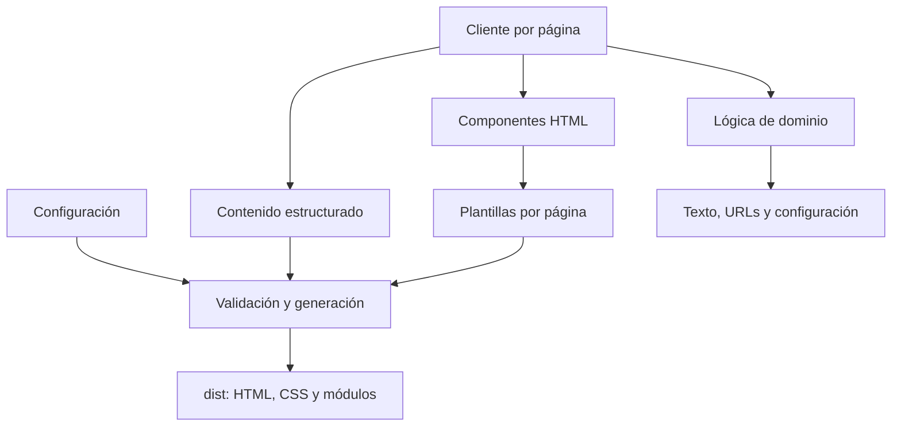

# Arquitectura

El proyecto utiliza generación estática y mejora progresiva. No requiere backend, base de datos ni un framework de interfaz para su alcance actual. Los artículos y enlaces se entregan en HTML; búsqueda, ejercicios y preferencias se activan en el navegador.

## Responsabilidades y dependencias

| Capa | Responsabilidad | Restricción |
|---|---|---|
| `config` | Valores públicos y rutas | Sin secretos ni efectos sobre el DOM |
| `content` | Datos educativos y sus relaciones | Sin eventos ni estado de interfaz |
| `domain` | Reglas, búsqueda y transiciones | Sin DOM, almacenamiento ni plantillas |
| `ui` | Convertir datos y estados en HTML | Sin controladores del navegador |
| `client` | Eventos, almacenamiento y carga por página | Sin herramientas de build ni plantillas |
| `templates` | Documentos y secciones estáticas | Solo se ejecuta durante la generación |
| `tooling` | Validar, generar y servir localmente | No se publica en `dist/` |

Las pruebas de arquitectura comprueban las restricciones principales. Los módulos del cliente se cargan por página mediante `import()`. La portada no descarga las colecciones educativas; las rutas antiguas solo cargan artículos cuando necesitan resolver un enlace histórico a un módulo.

## Contenido y enlaces

Cada artículo tiene `id`, `slug`, contenido, `sourceIds` y `relatedArticleSlugs`. FAQ y glosario apuntan a slugs estables. El orden de una colección no determina sus relaciones. El tiempo de lectura se calcula a partir del texto.

La validación previa informa conjuntamente de IDs repetidos, campos vacíos, referencias inexistentes, opciones inválidas, teléfonos incompatibles y rutas inseguras. Las pruebas del HTML comprueban enlaces, anclas, metadatos y recursos generados.

Para añadir un artículo, completa su registro en `src/content/articles.js`, referencia fuentes existentes y agrega relaciones cuando correspondan. La ruta del artículo se genera automáticamente. Para añadir una página estática, declara sus metadatos en `src/config/routes.js`, crea su plantilla en `src/templates/pages/` y registra el renderizador en `tooling/routes.mjs`. Ejecuta `npm run check`; las pruebas con cantidades esperadas deben reflejar el cambio editorial deliberado.

## Estado interactivo

Cuestionarios y explorador utilizan transiciones puras: reciben estado y acción, y devuelven un estado nuevo. Los controladores del cliente conectan esas transiciones con eventos y renderizado. Esto permite comprobar retroceso, corrección, finalización y reinicio sin un navegador.

El adaptador de almacenamiento tolera navegadores que bloquean `localStorage`. El progreso de cuestionarios incluye una revisión del contenido para descartar respuestas incompatibles cuando cambian las preguntas. Se conservaron las claves previas para migrar el progreso disponible. El botón de privacidad borra solo las claves del sitio.

## Generación y desarrollo

El build valida primero, genera en una carpeta temporal y reemplaza `dist/` al completar todos los pasos. Si el renderizado falla, la salida anterior permanece disponible. Un bloqueo evita dos escritores sobre el mismo destino. La sustitución usa dos renombrados: no debe utilizarse como mecanismo de publicación en un servidor que esté atendiendo tráfico; el alojamiento debe publicar una versión completa.

`build-manifest.json` registra las páginas y sus hashes SHA-256. La salida es reproducible para el mismo contenido y configuración; no incluye fechas de compilación variables. La sustitución completa elimina recursos obsoletos.

`npm run dev` agrupa cambios próximos y serializa las reconstrucciones. Cada build usa un proceso Node nuevo para evitar que la caché ESM conserve contenido anterior. Hay reconstrucción automática, pero la recarga del navegador es manual.

Si un proceso se termina abruptamente, puede quedar `dist.lock/`. Comprueba que el PID de `dist.lock/owner.json` ya no corresponde a un build activo antes de quitar ese directorio y volver a generar.

## Evolución

Mantén esta estructura mientras el producto sea una biblioteca estática. Un CMS, formularios o autenticación requieren un contrato y una necesidad concretos; no hay infraestructura añadida para funciones que el sitio aún no utiliza.
